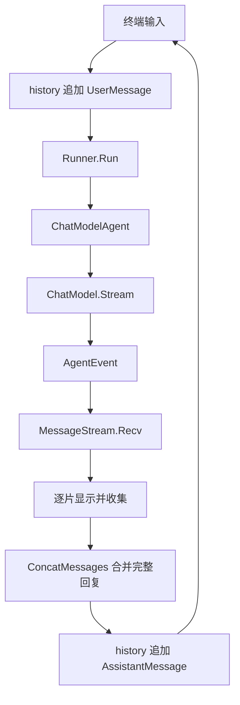

# 第二章：ChatModelAgent、Runner 与多轮对话

本章对照 CloudWeGo 官方示例：
https://github.com/cloudwego/eino-examples/blob/main/quickstart/chatwitheino/cmd/ch02/main.go

本次读取的上游文件 blob SHA 为 `edba94541f0a7251bed35eb0d24dd43a01ac04b5`。上游 main 分支会变化，下面说明对应本项目当前实现。

## 先运行，再打断点

在项目根目录执行：

```bash
CGO_ENABLED=0 go run ./cmd/new-chat-model-agent
```

需要 `.env` 中已有 `NEW_API_BASE_URL`、`NEW_API_KEY`、`NEW_API_MODEL`。底层模型服务需要支持流式聊天。

可以用以下两轮观察记忆效果（回复内容由模型决定）：

```text
you> 我叫小曹，正在学习 Eino。
assistant> ...
you> 我叫什么？正在学什么？
assistant> ...
```

空行或 EOF（macOS 终端通常按 Ctrl+D）结束。每行是一个问题，当前单行上限为 1 MiB；这不是模型的上下文长度限制。历史暂不裁剪，长对话会增加请求大小并可能达到模型上下文限制。历史只在内存里，重启就清空。

VS Code 选择 `Debug ch02 - ChatModelAgent 多轮对话`，按 F5，在**集成终端**输入。该配置把 cwd 设为项目根目录以读取 `.env`，并保持 `CGO_ENABLED=0`。第二章不使用 `.env` 中的 `USER_PROMPT`，系统提示词则仍支持 `SYSTEM_PROMPT` 和 `--instruction`。

## 从第一章到第二章

第一章直接调用模型，应用负责构造消息并取得模型响应。第二章在模型上方加入 Agent 和 Runner：



本章没有配置工具，因此主要展示模型回复。Agent 也不是自动具备跨轮记忆的模型；记忆来自我们每次传入的 history。

## 1. ChatModelAgent：给模型一个 Agent 外壳

位置：`internal/newchatmodelagent/run.go` 的 `runWithModel`。

```go
agent, err := adk.NewChatModelAgent(ctx, &adk.ChatModelAgentConfig{
    Name:        "Ch02ChatModelAgent",
    Description: "A console assistant with in-memory conversation history.",
    Instruction: systemPrompt,
    Model:       chatModel,
})
```

- `Name` 标识 Agent，便于区分事件来源。
- `Description` 描述 Agent 的用途；本章单 Agent 场景不依赖路由选择。
- `Instruction` 是模型执行任务的系统指令，本实现不会把它重复写入 history。
- `Model` 是现有 OpenAI-compatible ChatModel。项目仍通过共享初始化读取模型地址、密钥和名称。

可以把 Agent 理解为围绕模型组织执行逻辑的组件。后续章节可以加入工具与更复杂的控制流程，但这一章先理解最小闭环。

## 2. Runner：启动一次执行

```go
runner := adk.NewRunner(ctx, adk.RunnerConfig{
    Agent:           agent,
    EnableStreaming: true,
})
events := runner.Run(ctx, history)
```

Agent 和 Runner 在控制台启动时各创建一次；每个用户问题调用一次 `Run`。

`EnableStreaming: true` 让本章走模型的 `Stream` 路径。`Run` 返回事件迭代器，而不是最终的回复字符串。Runner 负责执行 Agent，并提供事件消费入口；不要把它理解为自动保存所有聊天历史的会话数据库。

## 3. 两层流：AgentEvent 与 MessageStream

位置：`run.go` 的 `runTurn`，以及 `events.go` 的 `printMessage`。

外层是 Agent 执行事件：

```go
event, ok := events.Next()
```

`Next` 会等待下一个事件，`ok == false` 表示本轮事件结束。一个事件不等于一个 token。应当先检查 `event.Err`，再判断是否有 `event.Output.MessageOutput`；不含消息的事件不应直接解引用。

内层才是某条输出消息的分片：

```go
chunk, err := stream.Recv()
```

`io.EOF` 表示这条消息读完，不代表错误。其他错误需向上传递。一个 chunk 可能包含多个字符，不能假定等于一个 token。

`MessageOutput.IsStreaming` 决定使用 `MessageStream` 还是完整的 `Message`。本项目虽然开启了流式，也保留完整消息分支，集中处理这两种表示。

读取时立即把 `chunk.Content` 写到终端，所以用户能逐步看到回复；与此同时将 chunk 收集起来，最后使用 `schema.ConcatMessages(chunks)` 合并成一条完整消息。直接只保留最后一个 chunk 会丢失之前的内容；只拼 Content 则会丢掉其他消息字段。

流只能按消费顺序读取。我们已调用 `Recv`，就不能再期望通过 `GetMessage()` 从同一个流重新获得完整回复。用 `defer stream.Close()` 保证读完或出错时释放 reader；每轮还有独立的取消 context，以便异常返回时通知未完成的执行停止。

## 4. 多轮记忆：每轮发送完整历史

假设用户依次输入“我叫小曹”和“我叫什么”。应用维护的 history 变化为：

```text
第一轮请求前：[user: 我叫小曹]
第一轮完成后：[user: 我叫小曹, assistant: 你好，小曹]
第二轮请求前：[user: 我叫小曹, assistant: 你好，小曹, user: 我叫什么]
```

Agent 再把 `Instruction` 加到模型输入的系统消息中。因此第二轮模型实际看到的是：

```text
system → user → assistant → user
```

模型能够回答名字，是因为请求再次携带了前一轮内容。只传最后一个 user 消息就会失去这段上下文。

代码只在本轮消息成功消费后追加回复。若流中途失败，终端可能已经显示部分文字，但程序会报错退出，不会将其当作完整回复进入下一轮。本章没有自动重试、持久化和失败后继续对话机制。

## 5. 建议的断点与观察值

| 断点 | 观察变量 | 应该看到什么 |
| --- | --- | --- |
| `runWithModel` 中追加 UserMessage 后 | `history` | 第二轮含第一轮完整问答 |
| `runTurn` 的 `runner.Run` | `history`、`runner` | 同一个 Runner，新的本轮执行 |
| `events.Next()` 后 | `event.Err`、`event.Output`、`event.AgentName` | 执行事件的外层结构 |
| `printMessage` 的 `stream.Recv()` 后 | `chunk.Content`、`err` | 逐段内容，最终 EOF |
| `ConcatMessages` 后 | `message` | 一条完整回复，供下一轮使用 |

流式循环中连续按 F10 会多次停在同一处，这是在读取不同分片。若断点暂停太久，远端模型连接可能超时。

## 与官方示例的对应关系

| 官方示例 | 本项目 |
| --- | --- |
| `cmd/ch02/main.go` | `cmd/new-chat-model-agent/main.go` + `internal/newchatmodelagent/run.go` |
| `chatmodel.NewModel[M]` | `shared.NewChatModel` |
| `NewTypedChatModelAgent[M]` | `NewChatModelAgent`（采用 `schema.Message`） |
| `NewTypedRunner[M]` | `NewRunner` |
| `helpers.PrintAndCollect` | `runTurn` + `printMessage` |
| `msgops.NewUser / NewAssistant` | `schema.UserMessage` + 合并后的模型回复 |

上游当前同时演示 `schema.Message` 与 `schema.AgenticMessage`，并有 `msgops`、消息输入归一化等公共封装。本项目只沿用现有 `schema.Message` 的纯文本场景，不引入双类型切换或后续章节的工具协议处理。这样可以直接在本地看到事件读取与历史追加的细节。

## 验证范围

`run_test.go` 使用替身模型替代外部 API，运行真实 Eino Agent/Runner，验证两轮上下文、系统指令、分片拼接、空输入/EOF 和错误传播。测试不访问真实模型服务，因此真实服务的认证、网络和流式兼容性仍需要你运行示例确认。
