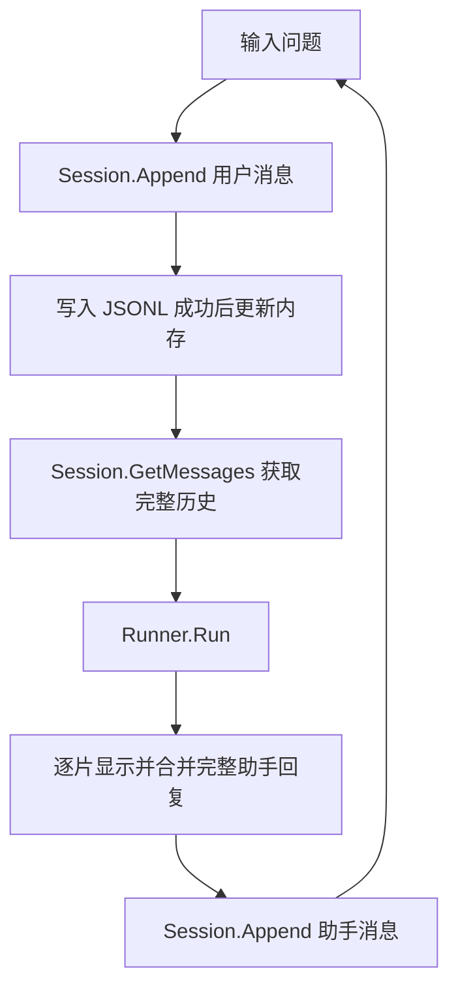

# 第三章：Memory 与 Session（持久化对话）

本章对照用户提供的官方文档：
https://www.cloudwego.io/zh/docs/eino/quick_start/chapter_03_memory_and_session/

同时核对了官方 `chatwitheino/cmd/ch03/main.go`（blob `a5e2f62492d448211bb55e9bced8d6e8032cc3c1`）和 `mem/store.go`（blob `48a5ab19b7d4aa2c441e568770d77ae220217020`）。本文解释本项目的实现，并标出与上游的区别。

## 先做一个跨进程实验

模型配置沿用项目根目录 `.env` 的 `NEW_API_BASE_URL`、`NEW_API_KEY` 和 `NEW_API_MODEL`。从项目根目录运行：

```bash
# 创建或打开名为 lesson03 的会话
CGO_ENABLED=0 go run ./cmd/memory-session --session lesson03
```

输入“我叫小曹，正在学习 Eino”。等完整回复输出后，输入空行退出。然后再次执行同一条命令：

```bash
CGO_ENABLED=0 go run ./cmd/memory-session --session lesson03
```

这次输入“我叫什么？正在学习什么？”。启动提示中的“已加载 N 条消息”和模型输入可以证明历史已恢复；模型的具体措辞不固定。测试代码还会直接检查第二次执行送给模型的历史。

其他操作：

```bash
# 不指定 ID，每次生成一个新的随机会话 ID
CGO_ENABLED=0 go run ./cmd/memory-session

# 列出已保存会话，找回 ID；此操作不调用模型，也不要求模型密钥
CGO_ENABLED=0 go run ./cmd/memory-session --list

# 自定义目录；恢复时传入同一目录和会话 ID
CGO_ENABLED=0 go run ./cmd/memory-session --session lesson03 --session-dir ./data/sessions/my-study
```

也可以用 `make run-memory-session` 新建会话。目录优先级为 `--session-dir` > `SESSION_DIR` 环境变量或 `.env` 配置 > `data/sessions`。默认目录已加入 gitignore；目录外的自定义存储路径需要自行忽略。

`--session` 表示获取或创建：指定一个不存在的 ID 会新建，拼错 ID 也会创建新的空会话。允许 1–128 位英文字母、数字、下划线和连字符。

## 第二章和第三章到底差在哪里

| 关注点 | 第二章 | 第三章 |
| --- | --- | --- |
| 历史在哪里 | 函数中的切片 | Session 内存切片 + 磁盘 JSONL |
| 程序退出后 | 历史丢失 | 下次根据 ID 加载 |
| 给 Runner 的参数 | `history` | `session.GetMessages()` |
| 模型和流式输出 | ChatModelAgent + Runner | 同样的机制，复用事件消费代码 |
| 多个对话 | 每次运行一个临时对话 | 不同 ID 对应不同文件 |

**本章的 Session、Store、Memory 属于业务层。** Eino 负责执行 Agent；我们负责存储消息，再把消息切片交给 `runner.Run`。这里的 Session 也不要与 ADK 执行上下文中的状态、checkpoint 或中断恢复混为一谈：保存聊天消息不等于保存任意正在运行的工作流。

## 三个概念

- **Memory**：本章对“把历史持久保存并重新取出”这项能力的称呼，代码中不需要再造一个名为 Memory 的类型。
- **Session**：一个具体会话，包含 ID、创建时间、消息列表以及对应文件路径。
- **Store**：管理一个目录里的多个 Session，负责获取/创建、列出和删除。

代码位置：

| 文件 | 职责 |
| --- | --- |
| `cmd/memory-session/main.go` | 命令行、环境变量、会话列表 |
| `internal/memorysession/run.go` | 控制台输入、会话与 Runner 的衔接 |
| `internal/mem/store.go` | Store、ID、缓存、列表、删除 |
| `internal/mem/session.go` | JSONL 读写、Append、GetMessages、Title |
| `internal/agentconsole/turn.go`、`events.go` | 第二章已经学过的事件流消费与回复合并 |

## 一轮对话的顺序



控制台的核心代码是：

```go
session.Append(schema.UserMessage(question))
history := session.GetMessages()
messages, err := agentconsole.RunTurn(ctx, runner, history, output)
// 检查 err；只保存成功收集的完整消息
for _, message := range messages {
    session.Append(message)
}
```

这里省略了 Append 的错误判断以突出流程；实际代码对每一步都检查错误。

关键是**先保存问题，再调用模型**。模型调用出错时，用户输入仍在磁盘上。回复使用第二章的流式消费逻辑，只有完整消费成功后才保存，避免把中途断流的半句话当成完整回答。

## 打开 JSONL 文件看一眼

对于 `--session lesson03`，打开 `data/sessions/lesson03.jsonl`。结构类似：

```jsonl
{"type":"session","id":"lesson03","created_at":"2026-11-13T08:00:00Z","message_kind":"message"}
{"role":"user","content":"我叫小曹，正在学习 Eino。"}
{"role":"assistant","content":"你好，小曹！"}
```

第一行是会话元数据，之后每行是一条消息。实际模型消息可能还有 token 使用量、响应信息等字段，不一定只有 role 和 content。文本中的换行会编码成 `\n`，不会破坏“一行一条记录”。

追加时把单条消息编码为 JSON，然后加一个换行写到文件尾部，不必重写整段历史。`Append` 先写文件并同步，再更新内存；编码或打开文件失败不会在内存里留下“其实没保存”的消息。

加载时依次读首行、检查 ID 与消息类型，再恢复后续消息。这里严格检查损坏的 JSON、错误消息角色和未结束的尾行，报错时保留原文件，便于检查。**JSONL 容易逐行检查，但不会自动修复损坏数据。**

单条 JSONL 记录最多 16 MiB，控制台单次输入最多约 1 MiB。这些是示例的文件/输入保护限制，与模型的上下文 token 上限是不同概念。

## 恢复时为什么模型能“记得”

第一次运行保存：

```text
user: 我叫小曹
assistant: 你好，小曹
```

第二次运行加载这些记录，再追加“我叫什么？”：

```text
Runner 输入：user → assistant → user
模型输入：  system → user → assistant → user
```

`system` 来自当前 Agent 的 `Instruction`，不持久化在这个控制台会话里。恢复时仍使用当前 `SYSTEM_PROMPT` 或 `--instruction`；如果你曾自定义指令，想保持一致就要再次使用相同配置。

Store 的 `cache` 只是本进程的加速缓存。关闭程序后缓存会消失，但文件仍在；新程序创建新的 Store 时会从文件加载。这正是“跨进程恢复”的关键。

`GetMessages()` 返回新的切片，但消息对象应当按只读值使用。修改历史应通过明确的业务操作完成，不能直接改返回对象并期待它自动同步到文件。

## 会话管理

`Store.List()` 读取会话元数据和第一条用户消息生成的标题，按创建时间由新到旧显示。标题最多取前 60 个 Unicode 字符，不会把中文截成半个字符；空会话标题是 `New Session`。

`Store.Delete(id)` 删除对应文件并清除缓存。当前命令行没有暴露删除参数；通过代码调用时需要明确给定 ID。测试会验证删除后旧的 Session 对象不能向重建的同名文件继续写入。

## VS Code 怎么观察

使用两个配置：

1. **Debug ch03 - 新建持久化会话**：F5 后在集成终端聊天，记下输出的会话 ID。
2. **Debug ch03 - 恢复持久化会话**：输入上次的 ID，观察已加载消息数量。

如果使用自定义目录，两次调试要使用相同 `SESSION_DIR`，或为恢复配置补上同样的 `--session-dir` 参数。

推荐断点：

| 位置 | 观察什么 |
| --- | --- |
| `Store.GetOrCreate` | 当前是命中缓存、读文件还是创建文件 |
| `loadSession` 的消息循环 | 每一行如何变成 `schema.Message` |
| `Session.Append` | 磁盘写入与内存追加的先后顺序 |
| `session.GetMessages()` 后 | 恢复的旧问答与本轮新问题 |
| `agentconsole.RunTurn` | 熟悉的 Runner 接收同样的消息切片 |

## 本地实现与官方示例的取舍

- 沿用项目已有的 `schema.Message`，因此目录是 `data/sessions`、消息类型是 `message`。文档中的 AgenticMessage 示例使用 `content_blocks` 和 `sessions_agentic`，两种文件不能混着读取。
- 官方共享 `mem/store.go` 还包含后续章节的中断状态等功能；本章只实现消息存储和基本会话管理。
- 此处不静默跳过坏行，避免悄悄丢失学习对话；磁盘写入成功才改变内存。
- 一次只用一个进程操作同一个会话。进程内部的 mutex 不等于文件锁，不能保证多进程同时写同一 ID 时安全。
- 本地文件支持同一机器上重新启动程序后恢复；跨设备还需要同步文件或共享存储。
- 保存的是完整历史，尚无摘要、截断、向量检索或长期偏好提取。对话越长，请求越大，仍可能达到模型上下文上限。
- 失败时已保存的用户消息保留，部分回复不保存；恢复后没有自动重试或修复未完成轮次。本章也没有提供对整轮问答的数据库事务保证。

## 验证自己是否掌握

试着先预测结果，再运行：

1. 用 `--session alpha` 告诉模型名字，再用 `--session beta` 问名字：两个文件是否隔离？
2. 退出 alpha，再恢复 alpha：模型输入里多了哪些消息？
3. 创建一个全新 Store 对象：为什么 history 还能回来？
4. 只保留磁盘文件、重启程序：Runner 本身需要知道文件在哪里吗？

如果能从 `Append → GetMessages → RunTurn → Append` 这条调用链解释这四个问题，本章的核心就掌握了。
